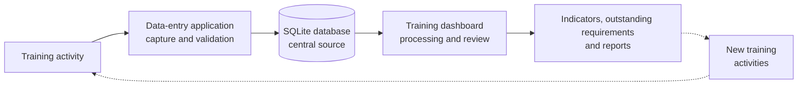

# Training pipeline

## Executive summary

This case study describes how three applications connect to support the tracking of safety talks and other Industrial Safety training activities: a data-entry application, a central database, and a dashboard for reviewing information.

The process begins when a person records an activity using the data-entry application. The information is validated and stored in the SQLite database. The dashboard then queries the same source, applies the business rules, and turns the records into indicators of training needs, completion, and outstanding requirements.

The original idea and first prototype of the data-entry application were developed by [saguirre-e](https://github.com/saguirre-e). Building on that proposal, I continued iterating on the tool, expanding its validation workflow and integrating it with the database and tracking system.

The result is a pipeline that connects daily operations with management: information recorded during data entry ultimately feeds the dashboards used to analyze progress and guide further action.

This document presents the overall architecture and the relationship between the components. The [data modeling case study](../capacitaciones.db/) explains the database structure, while the [dashboard case study](../capacitaciones/) describes training tracking.

## Context

Having a database and a dashboard did not, by itself, solve the whole problem. It was also necessary to control how new records entered the system.

If the same training session could be entered under different names, associated with the wrong person, or recorded more than once, those inconsistencies would eventually carry over into the indicators. Correcting them later was possible, but it meant reviewing information that had already passed through the entire process.

For that reason, a dedicated data-entry application was added. Its role is to apply common criteria at the source and ensure that both the people recording activities and those reviewing results work with the same information.

## How the pipeline works

### Data-entry application

This is the operational entry point. It allows users to select people, trainers, and training topics from predefined values, review the information before confirming it, and record multiple participations in a single submission.

The application queries the SQLite database for the current staff roster and the catalogs it needs to build the forms. After validating the input, it writes the records to the corresponding historical tables. This way, it does not maintain its own copy of the information or use intermediate files.

### Database

This is the integration point between the systems. It centralizes historical records, catalogs, the staff roster, and the rules needed to build the populations used for tracking.

The data-entry application uses it to read valid values and save new activities. The dashboard uses it as a source for queries. The two applications interact through the database rather than communicating directly with each other.

The design and internal rules of this layer are documented separately in [Data modeling in SQLite](../capacitaciones.db/).

### Tracking dashboard

This is the analytical layer of the pipeline. It queries the database without modifying it, combines completed activities with the current staff roster and the needs defined for each organizational unit, and calculates completion indicators.

The information is presented in a dashboard with filters, charts, lists of people with outstanding training requirements, and exportable reports. Its operation and calculation rules are described in more detail in [safety talk tracking](../capacitaciones/).

## Why SQLite

The choice of SQLite was driven primarily by the available infrastructure constraints. The department did not have a server on which to install and administer SQL Server or an equivalent engine, nor an approved budget for a managed cloud database.

It was technically possible to install SQL Server on a work computer and expose it on the network. However, that would have turned a workstation into an improvised server. Availability would depend on the computer remaining on and connected, and any restart, update, or failure would affect all users. The engine would also compete for memory, processing power, and disk resources with the normal use of a computer that was not sized to operate as a server.

That alternative would also have required managing network connections, permissions, the firewall, credentials, backups, and recovery from failures without dedicated infrastructure or support. An externally hosted web solution was also considered, but the free options were not suitable for the expected volume, queries, and connections, and there was no willingness to pay for a service.

SQLite made it possible to move forward with a portable solution, without a server process and with direct integration with Python. For the current usage pattern, consisting primarily of read queries and writes concentrated in controlled processes, it proved to be a sufficient and sustainable alternative.

The decision also has limits. SQLite allows multiple readers but serializes writes. SQL Server or another server-based engine would be more appropriate if concurrency, data-entry frequency, or the number of consuming applications grew significantly. The choice does not imply technical equivalence between the two engines; it is a pragmatic solution for the available context.

## Why it is a pipeline

Each component receives and prepares information needed by the next:

1. The data-entry application captures and validates the data.
2. The SQLite database stores it and relates it to the rest of the information.
3. The dashboard transforms it into indicators and tracking tools.
4. The results make it possible to identify outstanding requirements and plan new activities.

This is not a fully automated process: users confirm submissions and interactively consult the dashboard. Even so, there is a defined data flow, separate responsibilities, and a clear dependency between the outputs and inputs of each stage. For that reason, this document describes it as a pipeline.

## Result

Connecting the three components meant that data entry and analysis were no longer isolated processes. Records are entered according to common criteria, made available in a central source, and can be used to recalculate indicators reproducibly.

The pipeline's main value lies not in a particular technology, but in the continuity between the activity performed, its recording, and subsequent tracking. That connection makes it possible to identify people with outstanding training requirements, compare progress, and use the information to guide the program's next actions.

## Disclaimer

This case study describes concepts, decisions, and relationships between systems developed in a corporate environment. Names have been adapted, and internal paths, production data, and sensitive organizational information have been omitted.
